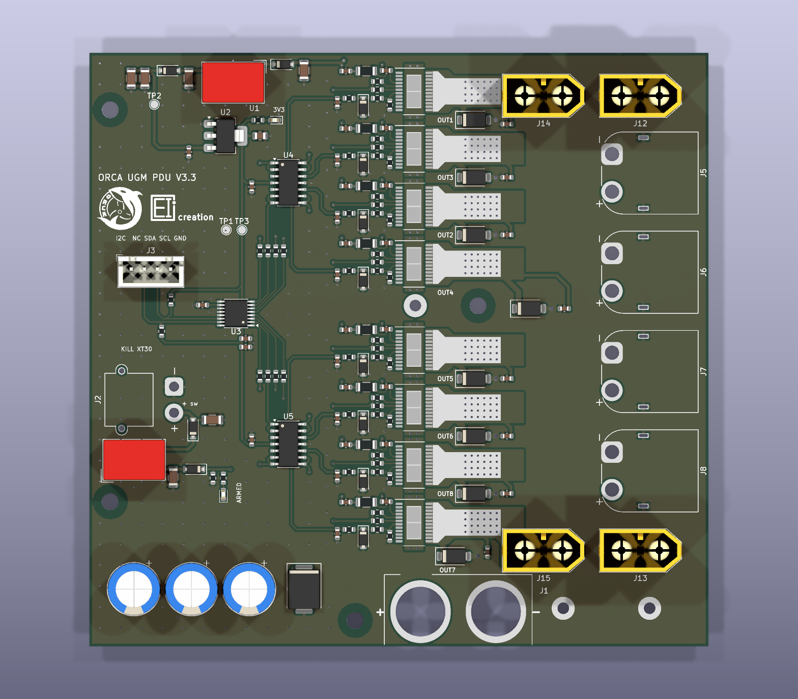
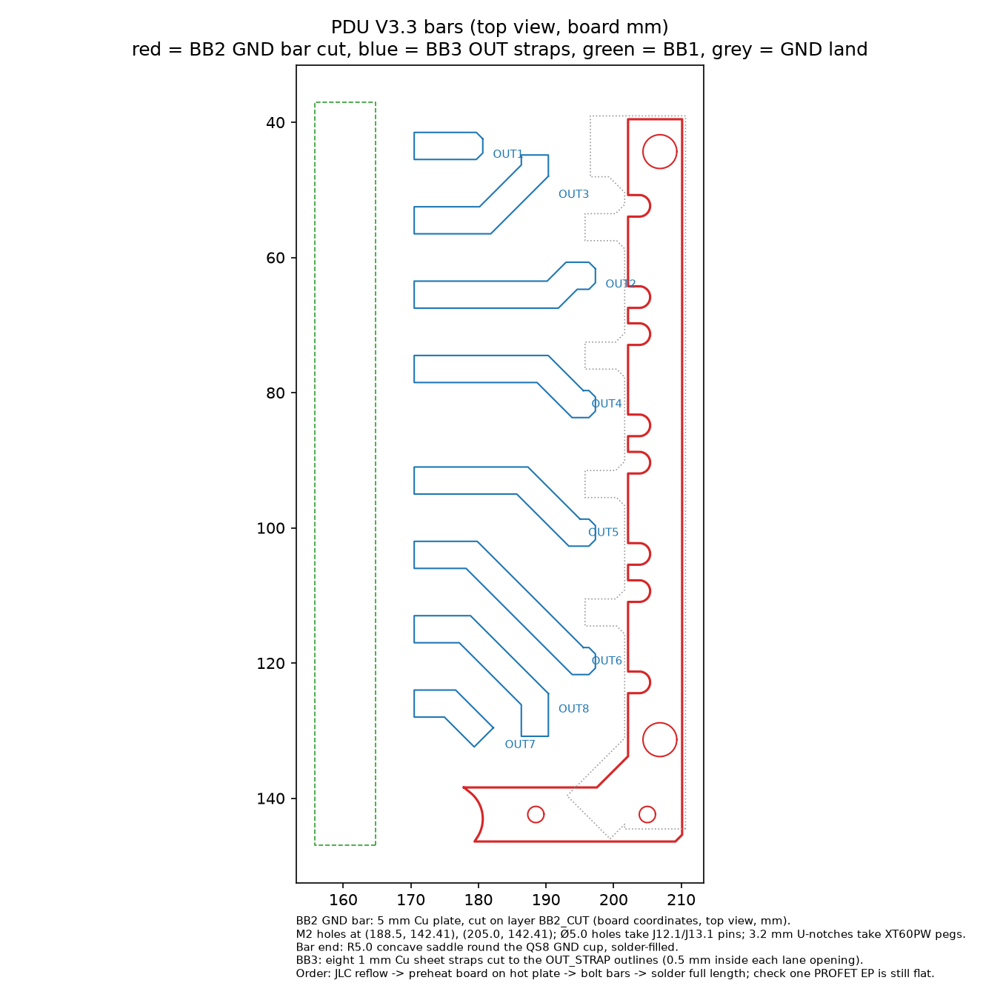
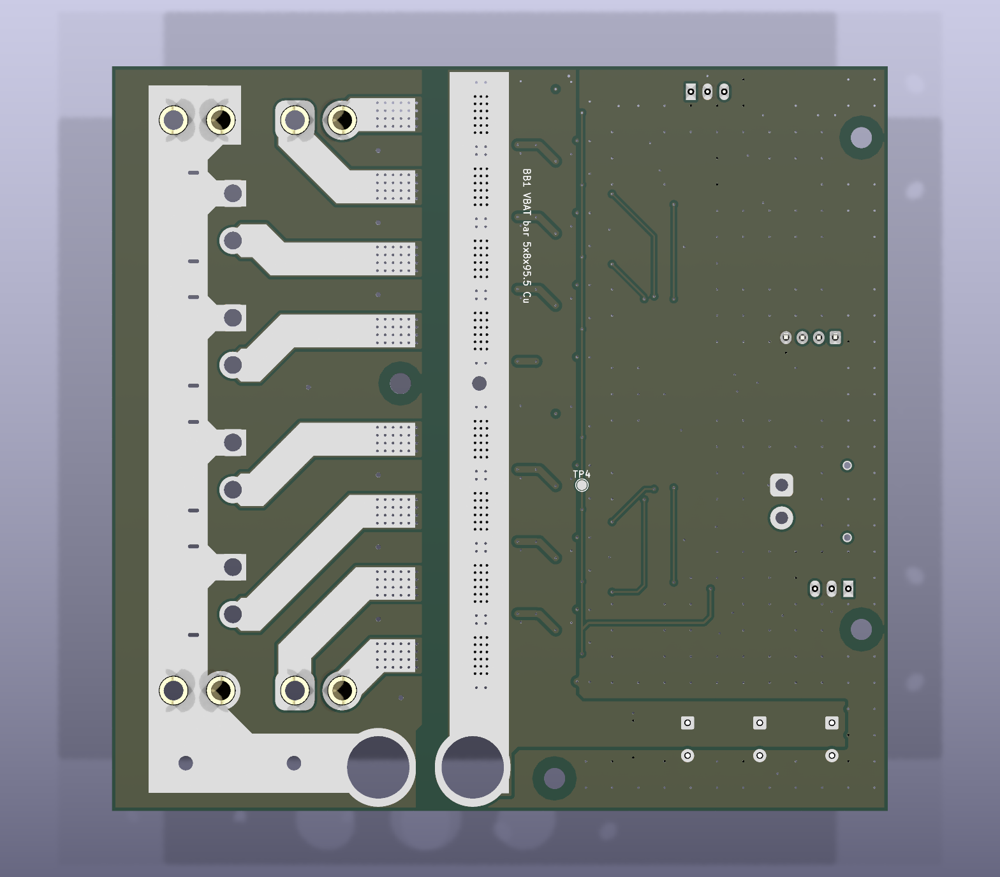

<p align="center">
  
</p>

<p align="center">
  
  
  
  
  
  
</p>

**PDU_V3_3** is the power distribution board of the ORCA UGM underwater vehicle. It switches the 4S thruster battery
to 8 thruster ESCs through 8 Infineon PROFET+2 high-side switches (BTS70012-1ESP, one per thruster), measures the
current of every channel, and cuts all thrusters when the kill switch is pulled.

The PROFET channel and current-sense chain are copied from
[dingoPDM-Max](https://github.com/corygrant/dingoPDM-Max) (V1.2 schematic p.7-11).

- **Input:** QS8-S anti-spark connector (J1), soldered to a 5 mm copper VBAT busbar (BB1)
- **Outputs:** 4 right-angle XT60PW (J5-J8) + 2 stacked XT60 (J14, J15) for the upper board (V2_atas), 2 stacked XT60 GND (J12, J13)
- **Protection per channel:** short-circuit latch-off (~3 µs), over-temperature, BYG23M flyback, 10 nF output cap; SMCJ17A TVS on VBAT
- **Current sense:** IS → 1.2 kΩ → 3V3 zener clamp → LM324 follower → ADS7828 (12-bit, I2C 0x48) on J3
- **Kill:** XT30 (J2) switched battery → TSR 1-2450 → `KILL_EN` → IN/DEN of all 8 PROFETs

> [!WARNING]
> This board was designed by students for a research vehicle, not by a professional. Use it at your own risk; the
> designers are not responsible for damage or injury. The busbars (BB1, BB2, BB3) are **mandatory**: without them the
> copper reaches >100 °C at 14 A per thruster.

---

## Specifications

| Item | Value |
| --- | --- |
| Battery | 4S Li-ion/LiPo, 16.8 V max (PROFET V<sub>S(NOR)</sub> 6-18 V, abs. max 28 V) |
| Channels | 8 × BTS70012-1ESP, 1 thruster each |
| Design current | 14 A per thruster continuous (112 A total), simulated T<sub>j</sub> 58-61 °C with busbars |
| Board | 118.2 × 113.6 mm, 2 layers, 2 oz copper, 1.6 mm |
| Logic | +5 V (TSR 1-2450) → +3V3 (LD1117S33), always on |
| ADC | ADS7828 @ 0x48, internal reference on (PD1 = 1), I ≈ code / 58.3 A |
| Fault | latched fault reads ≥ 2000 codes (≈ 2950 typ.); reset = IN low ≥ 100 ms (pull the kill) |

---

## Channel Map

The OUT2/OUT3 connectors were swapped so every output lane stays on one copper layer. Firmware must use this table.

| Connector pin | Net / PROFET | ADS7828 channel |
| --- | --- | --- |
| J14.2 (stack) | OUT1 / U101 | CH7 |
| J5.2 | OUT2 / U201 | CH4 |
| J14.1 (stack) | OUT3 / U301 | CH5 |
| J6.2 | OUT4 / U401 | CH6 |
| J7.2 | OUT5 / U501 | CH1 |
| J8.2 | OUT6 / U601 | CH2 |
| J15.2 (stack) | OUT7 / U701 | CH0 |
| J15.1 (stack) | OUT8 / U801 | CH3 |

J3 (JST-XH 4p to the Jetson): pin 1 NC, pin 2 SDA, pin 3 SCL, pin 4 GND.

> [!IMPORTANT]
> The Jetson/Pixhawk run from a separate battery, but their ground is already joined to the thruster ground through
> the ESC PWM leads and J3. Bond the system ground to a BB2 GND bolt with one 18-20 AWG wire so this current does
> not flow in the thin signal wires, twist SDA/SCL and every PWM lead with its ground, and do not connect the ESC
> BEC (red) wires to the Pixhawk.

---

## Ordering (JLCPCB)

1. Upload `Export/V3.3/PDU_V3_3_gerbers.zip`: 2 layers, 1.6 mm, **2 oz outer copper**.
2. PCB Assembly, top side: `PDU_V3_3_BOM_JLC.csv` + `PDU_V3_3_CPL_JLC.csv` (only the 8 PROFETs, LCSC C3232444).
   Check the pin-1 orientation in the JLC preview.
3. Order a top-side stencil and hand-place the remaining SMD parts from `PDU_V3_3_BOM_full.csv`.
4. Cut the busbars from `PDU_V3_3_busbars.dxf`, bolt them (M2), then solder them along their full length.

<p align="center">
  
</p>

---

## What's Inside

```text
PDU_V3_3/
|-- PDU_V3_3/                        # KiCad 9 project
|   |-- PDU_V3_3.kicad_pro / _sch / _pcb
|   |-- V3_3.kicad_sym               # local symbols
|   |-- V3_3.pretty/                 # local footprints: QS8-S, XT60PW with GND pegs, busbars, PROFET, logos
|   |-- fp-lib-table, sym-lib-table  # point to the local libraries (${KIPRJMOD})
|
|-- Export/V3.3/
|   |-- PDU_V3_3_gerbers.zip         # gerbers + drill files for JLCPCB
|   |-- PDU_V3_3_BOM_JLC.csv         # JLC assembly BOM (8x BTS70012-1ESP)
|   |-- PDU_V3_3_CPL_JLC.csv         # JLC pick-and-place for the PROFETs
|   |-- PDU_V3_3_BOM_full.csv        # full BOM for hand assembly
|   |-- PDU_V3_3_schematic.pdf       # schematic
|   |-- PDU_V3_3.step                # 3D model
|   |-- PDU_V3_3_busbars.dxf         # BB1/BB2/BB3 cut drawing
|
|-- Images/                          # renders used in this README
```

---

## Notes

- Open the project with **KiCad 9**. Saving it in KiCad 10 makes it unreadable for KiCad 9.
- The QS8-S footprint comes from a measured part; there is no official QS8-S drawing.
- Bottom side:

<p align="center">
  
</p>
